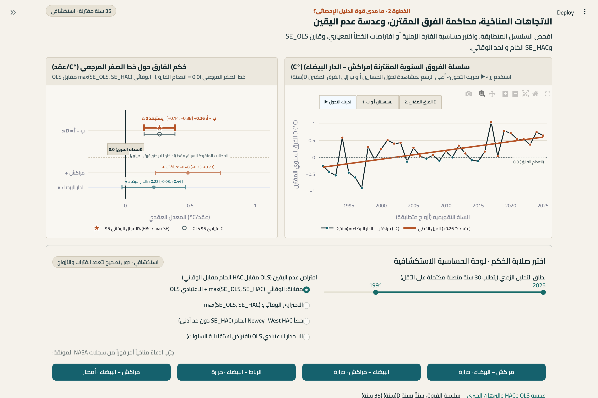
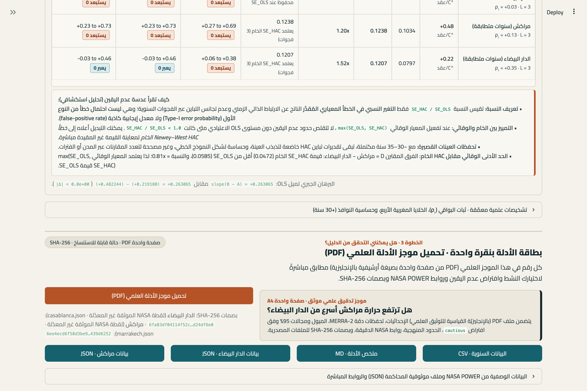
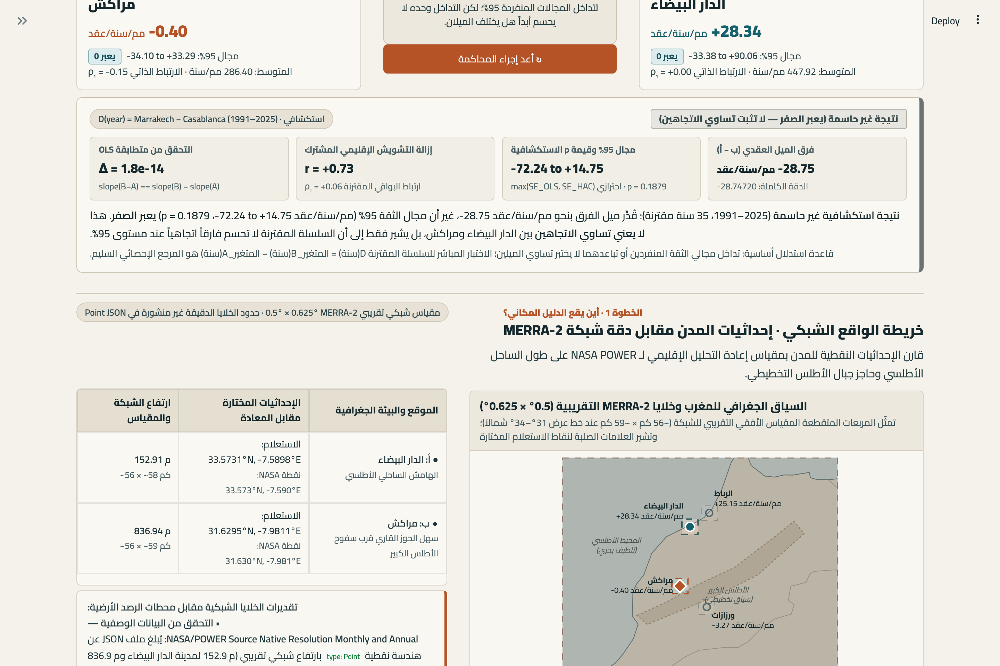
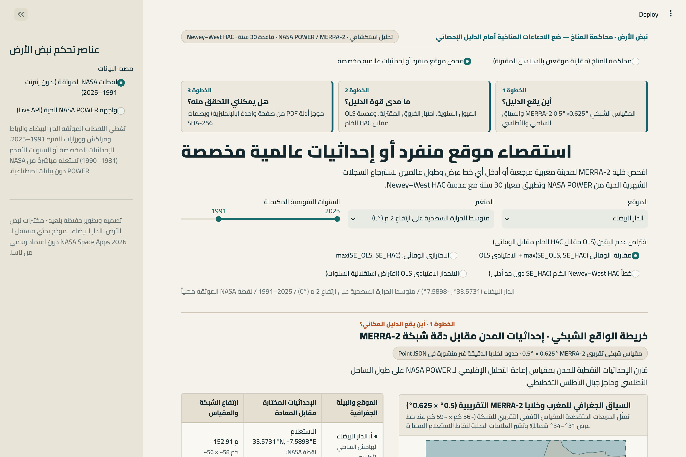

# نبض الأرض · محاكمة المناخ (`EarthPulse`)

**ضع الادعاءات المناخية أمام الدليل الإحصائي** — تطبيق ويب علمي تفاعلي بواجهة عربية تقنية متكاملة (`RTL`) مخصّص لتحدي تطبيقات ناسا الفضائية 2026 (**NASA Space Apps Challenge 2026**).

يجمع المشروع بين تحليل السلاسل الزمنية المناخية المستمدة من بيانات **NASA POWER / MERRA-2** واختبار الفروق المقترنة بين المواقع، مع إبراز دقة الخلايا الشبكية، ومقارنة أخطاء التقدير المعيارية بين الانحدار الخطي الاعتيادي (**OLS**) ومقدّر **Newey–West HAC** المقاوم للارتباط الذاتي، وتوليد موجز أدلة علمي موثّق بصيغة PDF قابل للتحميل.

> **التطبيق المباشر:** [earthpulse-labs-hafidaso.streamlit.app](https://earthpulse-labs-hafidaso.streamlit.app/)  
> **العرض التقديمي (بالإنجليزية):** [`EarthPulse-Demo.pdf`](EarthPulse-Demo.pdf)


---

## الفكرة العلمية الأساسية

تنتج كل معادلة انحدار خطي ميلاً رقمياً، غير أن الميل الظاهري قد يخدع صانع القرار لسببين إحصائيين جوهريين:

1. **تجاهل الذاكرة الزمنية للمناخ (`OLS` مقابل `Newey–West HAC`):** يفترض الانحدار الاعتيادي استقلالية كل سنة عن سابقتها، لكن الشذوذات الحرارية تميل للتجمّع عبر الزمن ($\rho_1 > 0$). في مدينة مثل الدار البيضاء (`1991–2025`)، ينتقل مجال الثقة `95%` من `[+0.057, +0.381]` (OLS، يبدو حاسماً) إلى `[-0.026, +0.465]` (Newey–West HAC، يعبر الصفر المرجعي ويصبح غير حاسم).
2. **فخّ تداخل المجالات المنفردة عند مقارنة مدينتين:** يتداخل مجال الثقة الوقائي للدار البيضاء `[-0.026, +0.465]` مع مجال مراكش `[+0.230, +0.734]` رغم أن مراكش تسجّل ميلاً مضاعفاً تقريباً. التداخل المنفرد **لا يختبر أبداً** هل يختلف الميلان إحصائياً. الحل الصحيح هو تكوين سلسلة الفروق المقترنة سنةً بسنة:

$$D(\text{year}) = \text{Variable}_B(\text{year}) - \text{Variable}_A(\text{year})$$

يُلغي الاقتران السنوي التشويش الإقليمي المشترك بين السلسلتين ($r = +0.83$ بين الدار البيضاء ومراكش)، ما يخفض الارتباط الذاتي لبواقي سلسلة الفرق إلى $\rho_1 = +0.03$ ويكشف فارق تسارع حقيقي يبلغ **`+0.26306 °C/عقد`** ($p = 8.12 \times 10^{-5}$ الاستكشافية، بمجال وقائي `95%`: `[+0.144, +0.382]`).

---

## تدفق العمل التفاعلي من ثلاث خطوات

يعمل التطبيق افتراضياً في وضع **محاكمة المناخ (مقارنة موقعين)** مع إمكانية التبديل في أي لحظة إلى وضع **فحص موقع منفرد أو إحداثيات عالمية مخصصة**:

| الخطوة | السؤال الإرشادي | المكوّن العلمي |
| :--- | :--- | :--- |
| **الخطوة 1** | **أين يقع الدليل المكاني؟** | **خريطة الواقع الشبكي:** عرض السياق الساحلي الأطلسي وحاجز الأطلس التخطيطي مع مربعات المقياس التقريبي لخلايا `MERRA-2` (`~0.5° × ~0.625°`؛ نحو `~56 كم × ~59 كم` فوق المغرب) ومقارنة الإحداثيات النقطية بارتفاعات الشبكة. |
| **الخطوة 2** | **ما مدى قوة الدليل الإحصائي؟** | **محاكمة الفرق المقترن وعدسة عدم اليقين:** تحول متحرك بين المسارين المنفردين وسلسلة $D(\text{year})$، لوحة حساسية الفترة (30 سنة مكتملة فأكثر)، برهان متطابقة OLS الجبري (`|Δ| < 1e-12`)، وعدسة المقارنة بين `SE_OLS` و`SE_HAC` الخام والحد الوقائي `max(SE_OLS, SE_HAC)`. |
| **الخطوة 3** | **هل يمكنني التحقق من الدليل؟** | **بطاقة الأدلة بنقرة واحدة:** زر **`تحميل موجز الأدلة العلمي (PDF)`** يولّد ملف A4 من صفحة واحدة باللغة الإنجليزية القياسية يضم السؤال، الإحداثيات، النتائج المحسوبة لحظياً، التحفظات المنهجية، روابط NASA POWER الدقيقة، وبصمات `SHA-256`. |



---

## لقطات موثقة من النظام

| خريطة الواقع الشبكي (الخطوة 1) | عدسة عدم اليقين OLS مقابل HAC الخام (الخطوة 2) |
| :---: | :---: |
|  |  |
| **بطاقة الأدلة PDF وبصمات SHA-256 (الخطوة 3)** | **حُكم غير حاسم — الهطول المطري (مراكش − الدار البيضاء)** |
|  |  |
| **وضع الموقع المنفرد والقائمة الجانبية** | **توافق العرض على شاشات الهواتف (390×844)** |
|  |  |

---

## النتائج الإحصائية الموثّقة (`1991–2025` · 35 سنة مكتملة)

جميع الأرقام مستخرجة مباشرةً من لقطات **NASA POWER / MERRA-2 Monthly and Annual (API v2.10.0)** المضمّنة في `data/` دون أي تعديل على القياسات الخام:

### أ) المقارنات المقترنة `D(year) = ب − أ`

| المقارنة | المتغير | فرق الميل / عقد | مجال 95% الوقائي `max(SE_OLS, SE_HAC)` | مجال HAC الخام `95%` | نسبة `SE_HAC / SE_OLS` | قيمة `p` (الوقائي) | الحُكم الاستكشافي |
| :--- | :--- | :---: | :---: | :---: | :---: | :---: | :--- |
| **مراكش − الدار البيضاء** | الحرارة `T2M` | `+0.26306 °C` | `[+0.144, +0.382]` | `[+0.167, +0.359]` | `0.81x` | `8.12e-05` | **فرق اتجاهي موجب** (`r = +0.83`، `ρ₁ = +0.03`) |
| **الرباط − الدار البيضاء** | الحرارة `T2M` | `+0.02098 °C` | `[-0.011, +0.053]` | `[-0.011, +0.053]` | `1.17x` | `0.197` | **نتيجة غير حاسمة** *(لا يعني تساوي الميلين)* |
| **مراكش − الدار البيضاء** | الهطول `PRECTOTCORR` | `-28.75 mm/yr` | `[-72.24, +14.75]` | `[-65.87, +8.37]` | `0.85x` | `0.188` | **نتيجة غير حاسمة** *(يعبر الصفر المرجعي)* |

### ب) الاتجاهات المنفردة والذاكرة الزمنية عبر المدن المغربية الأربع (`T2M`، `1991–2025`)

| المدينة (شبكة MERRA-2) | الميل / عقد | مجال `OLS 95%` | مجال `HAC 95%` | نسبة `SE_HAC / SE_OLS` | ارتباط البواقي `ρ₁` | ارتفاع الشبكة (م) |
| :--- | :---: | :---: | :---: | :---: | :---: | :---: |
| **الدار البيضاء** | `+0.219 °C` | `[+0.057, +0.381]` | `[-0.026, +0.465]` | `1.52x` | `+0.35` | `152.91` |
| **الرباط** | `+0.240 °C` | `[+0.082, +0.398]` | `[+0.000, +0.480]` | `1.52x` | `+0.37` | `100.66` |
| **مراكش** | `+0.482 °C` | `[+0.272, +0.693]` | `[+0.230, +0.734]` | `1.20x` | `+0.13` | `836.94` |
| **ورزازات** | `+0.495 °C` | `[+0.301, +0.690]` | `[+0.260, +0.731]` | `1.21x` | `+0.22` | `1556.79` |

---

## القواعد والقيود العلمية المعتمدة

- **استكشافي لا توكيدي:** لا يطبّق التحليل أي تصحيح لتعدد المقارنات عند تبديل المدن أو المتغيرات أو النوافذ الزمنية.
- **شرط الـ 30 سنة متصلة مكتملة:** يتم تجميع السنوات من الشهور الـ 12 بأوزان الأيام الفعلية (مع احترام السنوات الكبيسة)، ويُستبعد أي عام ينقصه شهر واحد فوراً دون تعويض اصطناعي؛ كما يُعلَّق الاستدلال كلياً عند توفر أقل من 30 سنة متصلة.
- **دلالة نسبة `SE_HAC / SE_OLS`:** تقيس هذه النسبة **التغير النسبي في الخطأ المعياري المقدّر** نتيجة الارتباط الذاتي، و**ليست** احتمال خطأ من النوع الأول (`Type-I error`) ولا معدل إيجابيات كاذبة.
- **تفسير عدم الحسم:** عبور مجال الثقة للصفر يعني أن البيانات لا تحسم وجود فارق في الميل وفق الافتراض المختار؛ ولا يجوز تفسيره أبداً على أنه «برهان على تساوي الاتجاهين».
- **حدود التمثيل المكاني لشبكة `MERRA-2`:** تقترب الدقة الأفقية لـ NASA MERRA-2 من `0.5° × 0.625°`. ولأن استعلام النقطة في NASA POWER لا يُدرج زوايا مضلع الخلية داخل JSON، تُرسم المربعات المتقطعة بوصفها **نطاق مقياس تقريبياً متمركزاً حول الإحداثية المعادة**، دون أي تصحيح ارتفاعي محلي أو معايرة بمحطات الرصد الأرضية.
- **لغة الوثائق القابلة للتنزيل:** واجهة التطبيق وهذا الملف باللغة العربية التقنية، بينما يُصدَر **موجز الأدلة PDF** (صفحة واحدة A4، مثال مصوَّر أدناه) والعرض التقديمي [`EarthPulse-Demo.pdf`](EarthPulse-Demo.pdf) باللغة الإنجليزية للتوثيق والتحكيم العلمي الدولي.

<details>
<summary>معاينة صفحة موجز الأدلة العلمي المصدَّر بصيغة PDF (بالإنجليزية)</summary>


</details>

---

## التشغيل المحلي والاختبارات

يتطلب **Python 3.11+**:

```bash
python3 -m venv .venv
source .venv/bin/activate
pip install -r requirements.txt

# تشغيل حزمة الاختبارات العلمية والتكاملية الكاملة
python -m pytest -v

# تشغيل التطبيق التفاعلي محلياً (يعمل افتراضياً على لقطات NASA الموثقة مع خيار الاستعلام الحي)
streamlit run app.py
```

---

## بنية المستودع والملفات

| المسار | الدور |
| :--- | :--- |
| [`app.py`](app.py) | واجهة Streamlit العربية (`RTL`)، محاكمة المناخ التفاعلية، خريطة الواقع الشبكي، عدسة عدم اليقين، واستدعاء التصدير |
| [`analysis.py`](analysis.py) | محرك التحليل الإحصائي: تجميع NASA POWER الشهري بأوزان الأيام، Newey–West HAC، السلسلة المقترنة $D(\text{year})$، بيانات الشبكة، وبصمات `SHA-256` |
| [`brief_pdf.py`](brief_pdf.py) | مولّد موجز الأدلة العلمي من صفحة واحدة (`A4 PDF`) باللغة الإنجليزية انطلاقاً من الحالة النشطة |
| [`test_analysis.py`](test_analysis.py) | اختبارات آلية تغطي التجميع السنوي، تطابق ميل السلسلة المقترنة، HAC، خريطة الشبكة، توليد PDF، والبصمات |
| [`data/`](data/) | لقطات NASA POWER الموثقة لأربع مدن مغربية (`casablanca.json`, `rabat.json`, `marrakech.json`, `ouarzazate.json`) ونتائج مرجعية |
| [`EarthPulse-Demo.pdf`](EarthPulse-Demo.pdf) | عرض تقديمي تحكيمي من 9 شرائح (بالإنجليزية) |
| [`screenshots/`](screenshots/) | لقطات واجهة حقيقية ملتقطة بالمتصفح للنسخة النهائية |

---

## مصدر البيانات

- **NASA POWER Project (`MERRA-2 Native Resolution Monthly and Annual API v2.10.0`)**: [power.larc.nasa.gov](https://power.larc.nasa.gov/)
- **إعداد وتطوير:** [hafidaso](https://github.com/hafidaso/earthpulse) — NASA Space Apps Challenge 2026
