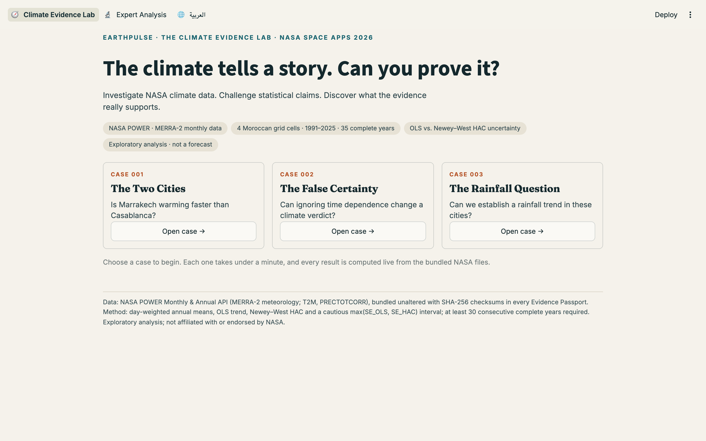
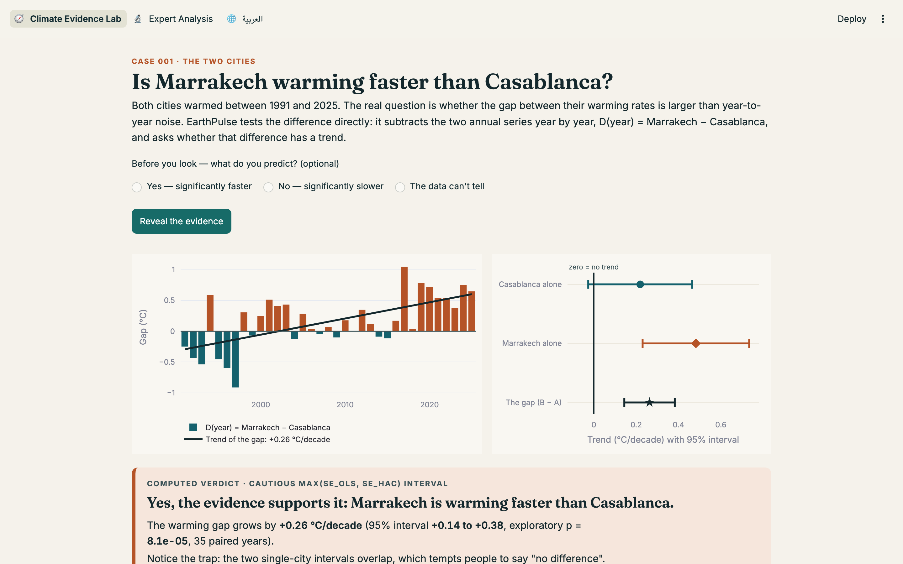
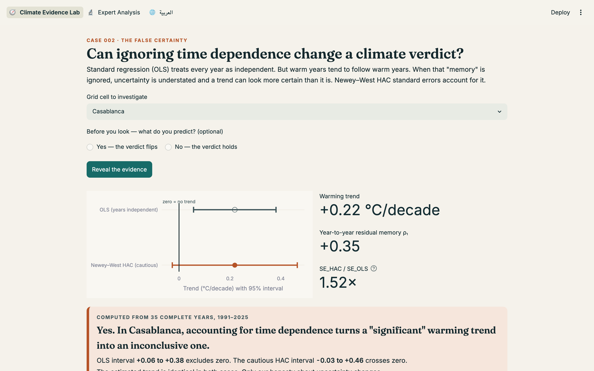
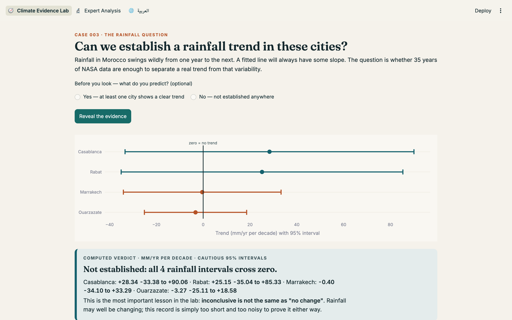

# EarthPulse — The Climate Evidence Lab & Climate Trial

**The climate tells a story. Can you prove it?**  
*Investigate NASA climate data. Challenge statistical claims. Discover what the evidence really supports.*

- **Live Public Deployment (Streamlit Cloud)**: [https://earthpulse-labs-hafidaso.streamlit.app/](https://earthpulse-labs-hafidaso.streamlit.app/)
- **7-Slide Judge Presentation Deck (PDF)**: [`EarthPulse-Demo.pdf`](EarthPulse-Demo.pdf)
- **Official Challenge**: [NASA Space Apps 2026 — "Be An Earth System Trend Detective!"](https://www.spaceappschallenge.org/2026/challenges/earth-system-trend-detective/)
- **Languages**: **English (Default Judge Experience)** + **Optional Full Arabic RTL Interface (`العربية` — نبض الأرض)** in the top navigation bar.



---

## 1. Why EarthPulse Exists

Every ordinary least-squares (OLS) regression line drawn through a climate record produces a numerical slope. However, **two common statistical errors** frequently distort climate trend claims:

1. **Ignoring temporal autocorrelation (`lag-1 r`)**: Treating consecutive years as statistically independent when warm or wet anomalies persist across years narrows confidence intervals artificially and can create false certainty.
2. **Misreading separate confidence intervals**: Inferring that two cities warm at the same rate merely because their individual 95% confidence intervals overlap—or claiming "no climate change" when an interval crosses zero (**an inconclusive interval crossing zero is not proof of zero change or equal trends**).

**EarthPulse** turns passive trend viewing into an interactive, reproducible scientific investigation backed by unaltered **NASA POWER / MERRA-2** records (`1991–2025`, `n = 35` complete years) across four distinct Moroccan climate regimes: **Casablanca**, **Rabat**, **Marrakech**, and **Ouarzazate**.

---

## 2. Three Modes in One Unified Application

Use the top navigation bar to switch seamlessly between:

1. **🧭 Climate Evidence Lab (Default First-Visit Experience — `lab.py`)**:
   - Designed for NASA judges and first-time visitors to investigate three guided cases in under 60 seconds:
     - **CASE 001 — THE TWO CITIES**: *"Is Marrakech warming faster than Casablanca?"*
       - Tests the paired annual difference series `D(year) = Variable_B(year) − Variable_A(year)` (`1991–2025`). Canceling shared interannual variance (`pair r = +0.83`) reveals a statistically significant warming difference of **`+0.26306 °C/decade`** (cautious 95% CI **`[+0.144, +0.382]`**, `p = 8.12e-05`), even though the two cities' individual cautious intervals overlap (`[-0.03, +0.46]` vs. `[+0.23, +0.73]`).
     - **CASE 002 — THE FALSE CERTAINTY**: *"Can ignoring time dependence change a climate verdict?"*
       - Compares conventional OLS (`[+0.06, +0.38] °C/decade`, `p = 0.0096`, excludes zero) against Newey–West HAC (`[-0.03, +0.46] °C/decade`, `p = 0.0786`, crosses zero) in Casablanca, where coastal thermal persistence (`lag-1 r = +0.35`) widens the standard error by **`1.52×`**.
     - **CASE 003 — THE RAINFALL QUESTION**: *"Can we establish a rainfall trend in these cities?"*
       - Examines corrected annual precipitation (`PRECTOTCORR`) across all four Moroccan grid cells (`1991–2025`). Every 95% interval crosses zero (e.g., Casablanca `+28.3 mm/yr/decade`, CI `[-33.4, +90.1]`; Marrakech `-0.4 mm/yr/decade`, CI `[-34.1, +33.3]`), illustrating why **an inconclusive result due to high interannual rainfall volatility is not proof of no change**.
   - Each case includes an optional **prediction check**, an **interactive visual reveal**, a **plain-English explanation**, a **one-click 1-page Scientific Evidence Brief (PDF)** with SHA-256 data checksums, and a direct link to the full Expert Analysis view.

| CASE 001 — The Two Cities | CASE 002 — The False Certainty | CASE 003 — The Rainfall Question |
| :---: | :---: | :---: |
|  |  |  |

2. **🔬 Expert Analysis (Full English Scientific Workbench — `expert_en.py`)**:
   - **The Climate Trial**: Compare any two locations (`Casablanca`, `Rabat`, `Marrakech`, `Ouarzazate`, or custom global coordinates fetched live from the NASA POWER API), adjust the analysis window (enforcing the WMO 30-consecutive-complete-years rule), inspect paired difference series `D(year)`, and verify the algebraic identity `OLS(B − A) = OLS(B) − OLS(A)`.
   - **Compare: The Trend Verdict** & **Single Location Diagnostics**: Zero-line dot-and-whisker plots, lag-1 residual persistence scatter (`e(t−1)` vs. `e(t)`), and rolling 30-to-35-year window sensitivity analysis.
   - **Three-Step Scientific Evidence Architecture**:
     - **STEP 1 — Where is the Evidence? (The Grid-Cell Reality Map)**: Interactive Plotly terrain and grid map showing the selected city coordinates alongside an explicitly labeled approximate `0.5° latitude × 0.625° longitude` (`~55 km × 59 km`) NASA MERRA-2 grid-cell scale footprint, Atlantic coastline, and schematic Atlas Mountains context.
     - **STEP 2 — How Strong is the Evidence? (The Uncertainty Lens)**: Compares `SE_OLS`, raw `SE_HAC`, and cautious `max(SE_OLS, SE_HAC)`. Explicitly documents that **`SE_HAC / SE_OLS` measures the relative change in standard error—it is NOT a Type-I error probability or false-positive rate**.
     - **STEP 3 — Can I Verify the Evidence? (One-Click Evidence Passport PDF)**: Generates a downloadable 1-page A4 PDF containing exact coordinates, analysis period, slopes, confidence intervals, methodology, limitations, NASA POWER request URLs, and **SHA-256 input checksums**.

3. **🌐 العربية (Optional Full Arabic RTL Interface — `expert_ar.py`)**:
   - Preserves the complete right-to-left (RTL) technical Arabic experience (**نبض الأرض — محاكمة المناخ**) for Arabic-speaking researchers, students, and decision-makers in Morocco and the MENA region.

---

## 3. Verified Scientific Results (`1991–2025`, `n = 35` Complete Years)

### A. Single-Grid-Cell Baseline Trends (Verified against `data/results.json`)

| Location | Variable | Annual Mean | OLS Slope / Decade | Conventional 95% CI (OLS) | Cautious 95% CI (`max(OLS, HAC)`) | Residual `lag-1 r` | `SE_HAC / SE_OLS` | Cautious Verdict |
| :--- | :--- | :---: | :---: | :---: | :---: | :---: | :---: | :--- |
| **Casablanca** | `T2M` (°C) | `18.70` | `+0.21918` | `[+0.05713, +0.38123]` | `[-0.02648, +0.46484]` | `+0.35` | `1.52×` | **Crosses 0 (Inconclusive)** |
| **Rabat** | `T2M` (°C) | `18.91` | `+0.24016` | `[+0.08196, +0.39837]` | `[+0.00019, +0.48014]` | `+0.37` | `1.52×` | **Excludes 0 (Borderline)** |
| **Marrakech** | `T2M` (°C) | `18.85` | `+0.48224` | `[+0.27184, +0.69265]` | `[+0.23036, +0.73413]` | `+0.13` | `1.20×` | **Excludes 0 (Warming)** |
| **Ouarzazate** | `T2M` (°C) | `16.44` | `+0.49548` | `[+0.30071, +0.69024]` | `[+0.25972, +0.73123]` | `+0.22` | `1.21×` | **Excludes 0 (Warming)** |
| **Casablanca** | `PRECTOTCORR` (mm/yr) | `447.9` | `+28.342` | `[-33.377, +90.062]` | `[-33.377, +90.062]` | `+0.00` | `0.81×` | **Crosses 0 (Inconclusive)** |
| **Rabat** | `PRECTOTCORR` (mm/yr) | `445.7` | `+25.145` | `[-35.040, +85.331]` | `[-35.040, +85.331]` | `+0.01` | `0.81×` | **Crosses 0 (Inconclusive)** |
| **Marrakech** | `PRECTOTCORR` (mm/yr) | `286.4` | `-0.405` | `[-34.095, +33.286]` | `[-34.095, +33.286]` | `-0.15` | `0.78×` | **Crosses 0 (Inconclusive)** |
| **Ouarzazate** | `PRECTOTCORR` (mm/yr) | `211.4` | `-3.269` | `[-25.115, +18.577]` | `[-25.115, +18.577]` | `-0.15` | `0.75×` | **Crosses 0 (Inconclusive)** |

### B. Paired Climate Trial Results (`D(year) = Variable_B(year) − Variable_A(year)`)

| Comparison (`B − A`) | Variable | Paired Slope Diff / Decade | OLS 95% CI | Cautious 95% CI (`max(OLS, HAC)`) | Cautious `p`-value | Inter-Site `r` | Paired `ρ₁` | Trial Verdict |
| :--- | :--- | :---: | :---: | :---: | :---: | :---: | :---: | :--- |
| **Marrakech − Casablanca** | `T2M` (°C) | **`+0.26306`** | `[+0.14408, +0.38205]` | **`[+0.14408, +0.38205]`** | `8.12e-05` | `+0.83` | `+0.03` | **Positive Trend Difference** |
| **Rabat − Casablanca** | `T2M` (°C) | `+0.02098` | `[-0.00856, +0.05053]` | `[-0.01148, +0.05344]` | `0.1976` | `+0.98` | `+0.21` | **Inconclusive (Not Equal)** |
| **Marrakech − Casablanca** | `PRECTOTCORR` (mm/yr) | `-28.747` | `[-72.226, +14.732]` | `[-72.226, +14.732]` | `0.1876` | `+0.69` | `+0.04` | **Inconclusive (Not Equal)** |

---

## 4. Official NASA Resources, References & AI Usage Disclosure

### NASA Resources Used (Meeting Challenge Requirements)
1. **[NASA POWER Monthly and Annual API (`v2.10.0`)](https://power.larc.nasa.gov/docs/services/api/temporal/monthly/)**: Primary data source (`AG` community, monthly `T2M` and `PRECTOTCORR`). Bundled unaltered in `data/*.json` with embedded request URLs and SHA-256 integrity hashes, plus live API querying for any global coordinate.
2. **[NASA GMAO MERRA-2 Reanalysis](https://gmao.gsfc.nasa.gov/reanalysis/MERRA-2/)**: Underlying meteorological reanalysis (`0.5° latitude × 0.625° longitude` horizontal grid spacing) powering the NASA POWER parameters.
3. **[NASA Giovanni](https://giovanni.gsfc.nasa.gov/giovanni/)**: Official challenge gridded-data visualization and exploration reference for MERRA-2 Earth system variables.

### Methodological & Software References
- **Newey, W. K., & West, K. D. (1987)**: *A Simple, Positive Semi-Definite, Heteroskedasticity and Autocorrelation Consistent Covariance Matrix*, Econometrica, 55(3), 703–708. [https://doi.org/10.2307/1913610](https://doi.org/10.2307/1913610)
- **Open-Source Stack**: Python 3.11+, Streamlit, Plotly, pandas, NumPy, SciPy, `statsmodels`, Requests, `pytest`, ReportLab, PyMuPDF (`fitz`). See [`REFERENCES.md`](REFERENCES.md).

### AI Usage Disclosure
In accordance with NASA Space Apps Challenge rules (see [`AI_DISCLOSURE.md`](AI_DISCLOSURE.md) and [`REFERENCES.md`](REFERENCES.md)):
- Generative AI coding tools were used to assist with software engineering, Streamlit UI layout, bilingual English/Arabic localization, PDF brief formatting, and automated test scaffolding.
- **Zero climate measurements, coordinates, or statistical outputs were generated or modified by AI.** All bundled JSON snapshots come unaltered from the NASA POWER API (`MERRA-2`), and every statistical figure is computed deterministically by `analysis.py` and verified by 20 automated `pytest` tests.

---

## 5. Scientific Limitations & Interpretation Guardrails

- **Grid-Cell Scale vs. Local Stations**: NASA POWER values represent `0.5° × 0.625°` (`~55 km × 59 km`) MERRA-2 reanalysis grid-cell averages (`152.93 m` mean elevation for Casablanca; `836.93 m` for Marrakech) without sub-grid DEM downscaling or local microclimate adjustments.
- **Inconclusive ≠ No Change**: A 95% confidence interval crossing zero indicates that linear trend direction cannot be separated from interannual variability over the selected window—it never proves that the true trend is zero or that two cities have identical trends.
- **Standard Error Ratio (`SE_HAC / SE_OLS`)**: Measures the relative change in standard error when accounting for serial correlation; it is **not** a Type-I error rate or false-positive probability.
- **Exploratory Scope**: All p-values and confidence intervals are exploratory two-sided `t` screens (`df = n − 2`) without family-wise multiplicity adjustment across cities or rolling windows, and statistical trends do not establish physical attribution.

---

## 6. Local Installation, Testing & Execution

```bash
python3 -m pip install -r requirements.txt
python3 -m pytest -v
python3 -m streamlit run app.py
```

### Repository Structure
- `app.py` — Top-navigation router (`Climate Evidence Lab` [default English], `Expert Analysis` [English], `العربية` [optional Arabic RTL])
- `lab.py` — Interactive first-visit storytelling experience (*The Climate Evidence Lab*: CASE 001, CASE 002, CASE 003)
- `expert_en.py` — Full English Expert Analysis workbench (*The Climate Trial*, *Compare: The Trend Verdict*, *Single Location*, and *STEP 1–2–3*)
- `expert_ar.py` — Full Arabic RTL workbench (*نبض الأرض — محاكمة المناخ*)
- `analysis.py` — Deterministic aggregation, OLS, Newey–West HAC, paired difference trial, and SHA-256 verification engine
- `brief_pdf.py` — One-page A4 Scientific Evidence Brief PDF generator (ReportLab)
- `test_analysis.py` — 20 automated regression tests covering data integrity, statistical identities, PDF generation, and repository hygiene
- `EarthPulse-Demo.pdf` — Strict **7-slide** judge presentation deck
- `data/` — Unaltered NASA POWER / MERRA-2 JSON snapshots (`casablanca.json`, `rabat.json`, `marrakech.json`, `ouarzazate.json`) and verified baseline (`results.json`)
- `REFERENCES.md` & `AI_DISCLOSURE.md` — Complete NASA data citations, methodological references, and AI usage disclosure
