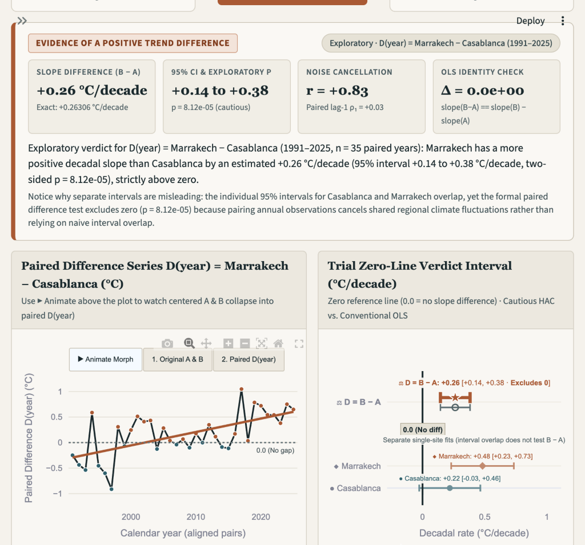
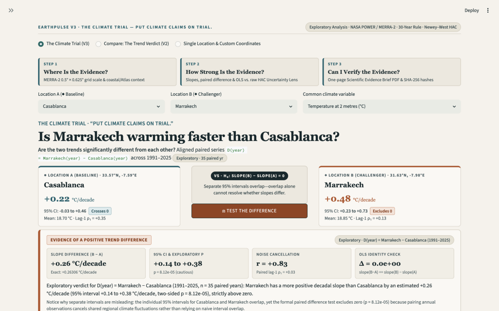
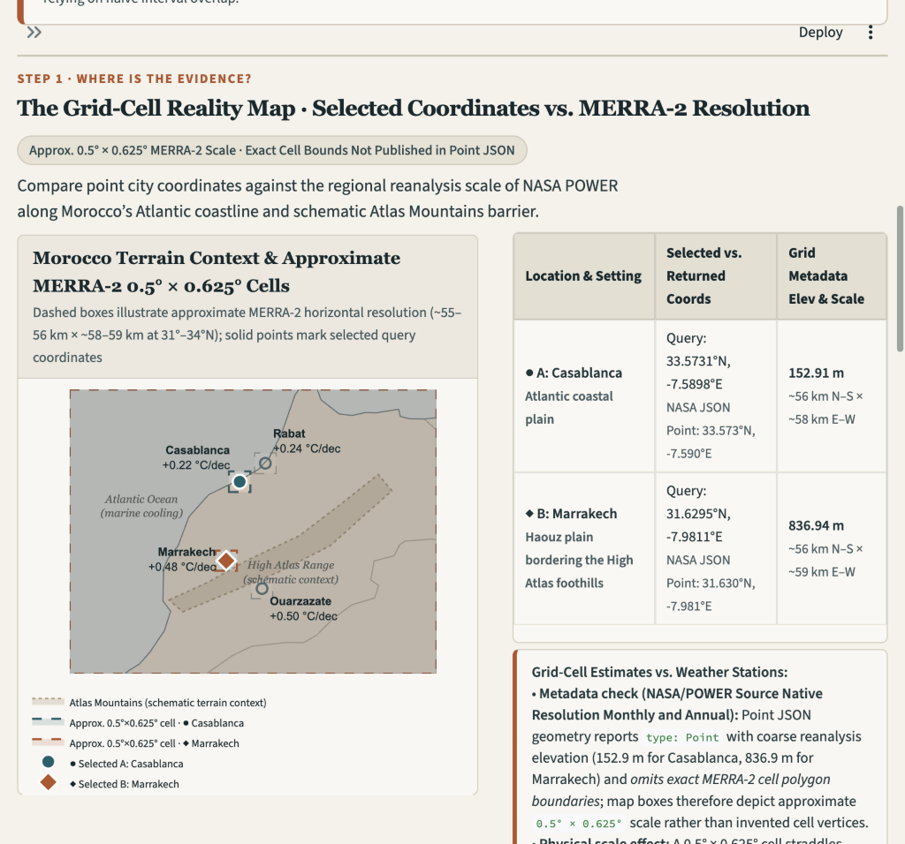
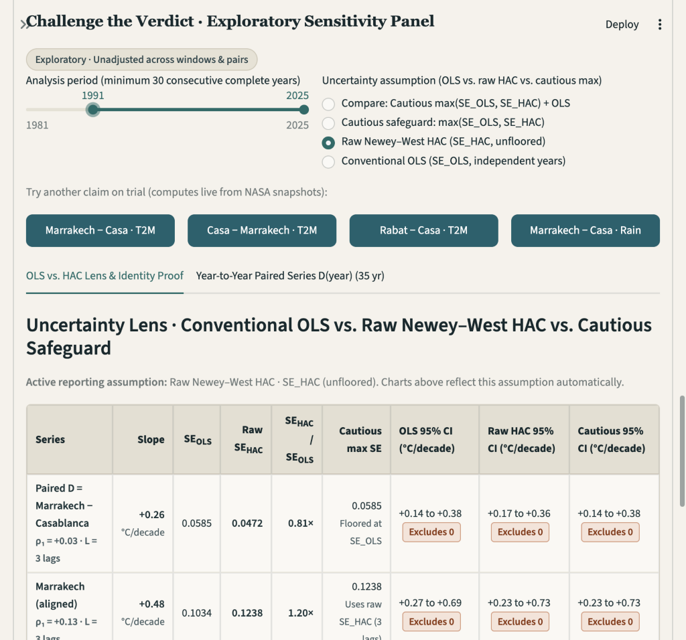
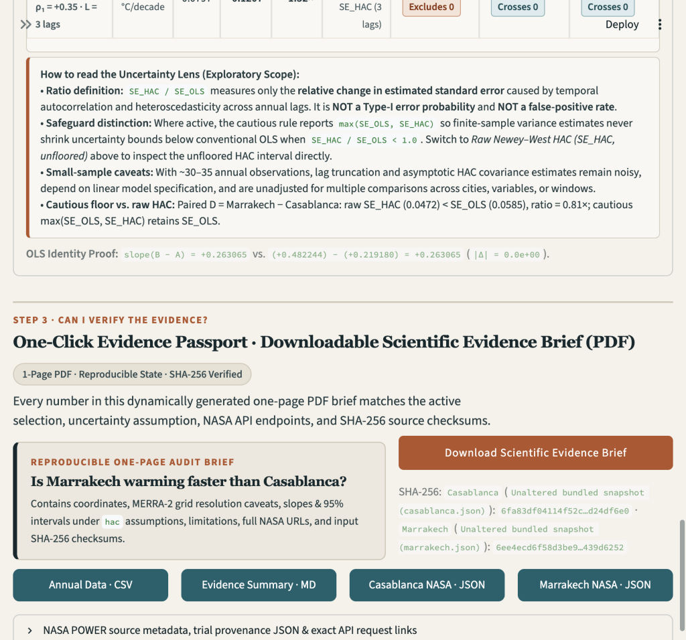
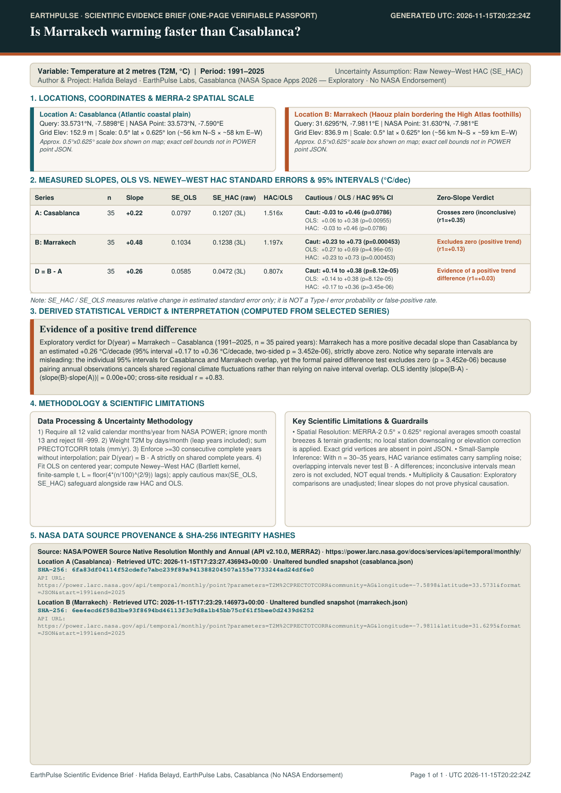

# EarthPulse V3 — The Climate Trial

**Hafida Belayd · EarthPulse Labs, Casablanca**  
An independent 2026 NASA Space Apps project for *“Be An Earth System Trend Detective!”*

> **Tagline**: *Put climate claims on trial.*

[Open the live EarthPulse dashboard](https://earthpulse-labs-hafidaso.streamlit.app/) · [Nine-slide demo (`EarthPulse-Demo.pdf`)](EarthPulse-Demo.pdf)



---

## What’s New in V3: *The Climate Trial*

V2 established why separate site confidence intervals can flip when residual time dependence is accounted for—leaving open a harder question: **overlapping single-site confidence intervals never test whether two trends actually differ from each other.**

**EarthPulse V3 (*The Climate Trial*)** adds an exploratory paired hypothesis test directly on the opening screen while preserving **Compare: The Trend Verdict (V2)** and **Single Location & Custom Coordinates** intact as switchable modes.

### 1. Climate Face-Off (`D(year) = Variable_B(year) − Variable_A(year)`)
- **Opening Trial Question**: *“Is Marrakech warming faster than Casablanca?”* — **“Are the two trends significantly different from each other?”**
- **Exact Year Alignment**: Aligns complete annual NASA POWER observations strictly by calendar year (`inner join` on completed years; incomplete/missing years drop cleanly from pairs without interpolation).
- **Direct Paired Estimation**: Estimates the linear slope per decade of `D(year)` (`°C/decade` or `mm/year/decade`), verifies the exact OLS identity (`slope(B − A) == slope(B) − slope(A)` over identical years), and applies Newey–West HAC vs. conventional OLS uncertainty intervals.
- **Derived Verdicts (Never Hard-Coded)**:
  - **Evidence of a positive trend difference**: e.g., **Marrakech − Casablanca (`T2M`, 1991–2025)** yields **`+0.26306 °C/decade`**, cautious 95% CI **`[+0.14397, +0.38215] °C/decade`**, exploratory `p = 8.12e-05`. Even though solo intervals overlap (`[-0.03, +0.46]` vs. `[+0.23, +0.73]`), year-by-year pairing removes shared regional fluctuations (`r = +0.83`, paired residual `ρ₁ = +0.03`).
  - **Evidence of a negative trend difference**: e.g., **Casablanca − Marrakech (`T2M`, 1991–2025)** yields **`-0.26306 °C/decade`**, cautious 95% CI **`[-0.38215, -0.14397] °C/decade`**, `p = 8.12e-05`.
  - **Inconclusive result**: e.g., **Rabat − Casablanca (`T2M`, 1991–2025)** yields **`+0.02098 °C/decade`**, cautious 95% CI **`[-0.01141, +0.05338] °C/decade`**, `p = 0.1966` (crosses zero), and **Marrakech − Casablanca (`PRECTOTCORR`)** yields **`-28.74720 mm/yr/decade`**, **`[-72.24153, +14.74714]`**, `p = 0.1879`. Inconclusive results explicitly state that crossing zero **does NOT establish equal trends**.

### 2. Animated Transformation & Challenge the Verdict Panel
- **Central `TEST THE DIFFERENCE` Action & Plotly Morph**: Reveals the paired verdict card and animates smoothly between centered original trajectories (`A − Ā`, `B − B̄`) and the paired annual difference series `D(year) = B − A` alongside a zero-line verdict whisker plot.
- **Challenge the Verdict (Exploratory Sensitivity Panel)**: Adjust the analysis period (`1981–2025`, enforcing the 30-consecutive-complete-years rule), switch between uncertainty assumptions (`Compare Cautious + OLS`, `Cautious safeguard`, `Raw Newey–West HAC`, `Conventional OLS`), run preset claims, verify the OLS difference identity, and inspect all year-to-year `D(year)` values.

### 3. Cohesive Three-Step Scientific Workflow (Features 1–3)
- **STEP 1 — Where Is the Evidence? (*The Grid-Cell Reality Map*)**: Interactive Morocco terrain map displaying Casablanca, Rabat, Marrakech, and Ouarzazate alongside selected query coordinates, coastal Atlantic & schematic High/Middle Atlas Mountains context, explicitly labeled approximate `0.5° lat × 0.625° lon` (~56 km × ~58–59 km at `31°–34°N`) MERRA-2 resolution boxes (since NASA POWER point JSON `geometry.type == "Point"` omits exact polygon corners), and coarse metadata elevation (`152.91 m` Casablanca, `836.94 m` Marrakech) with explicit station-vs-grid caveats and zero unsupported elevation downscaling.
- **STEP 2 — How Strong Is the Evidence? (*The Uncertainty Lens*)**: Interactive tabular comparison of conventional `SE_OLS`, raw Newey–West `SE_HAC` (`L` annual Bartlett lags), the `SE_HAC / SE_OLS` standard-error change ratio (`0.81×` paired D, `1.20×` Marrakech, `1.52×` Casablanca for `T2M`, `1991–2025`), and the cautious `max(SE_OLS, SE_HAC)` safeguard alongside OLS / Raw HAC / Cautious 95% intervals and zero-line status. Explicitly documents that **`SE_HAC / SE_OLS` is NOT a Type-I error probability or false-positive rate** and distinguishes unfloored raw `SE_HAC` from `max(SE_OLS, SE_HAC)`.
- **STEP 3 — Can I Verify the Evidence? (*One-Click Evidence Passport PDF*)**: Primary **`Download Scientific Evidence Brief`** button (`brief_pdf.py`, ReportLab) producing a downloadable **1-page A4 PDF** directly from the currently active selection—complete with investigation question, city coordinates, MERRA-2 resolution caveats, measured slopes, OLS/HAC/Cautious CIs, derived verdict, limitations, exact NASA API request URLs, UTC generation timestamp, author/project attribution, and SHA-256 checksums matching unaltered bundled snapshots or canonical live NASA JSON payloads (plus secondary `.csv`, `.md`, and `.json` exports).

---

## Verified V3 Paired Trial Results (`1991–2025`, `n = 35` Paired Years)

| Claim (`D = B − A`) | Variable | Slope Diff / Dec | Cautious 95% CI (HAC) | Paired `p` | Paired `ρ₁` | Derived Exploratory Verdict |
| :--- | :--- | :---: | :---: | :---: | :---: | :--- |
| **Marrakech − Casablanca** | `T2M` (°C) | `+0.26306` | **`[+0.14397, +0.38215]`** | `8.12e-05` | `+0.03` | Evidence of a positive trend difference |
| **Casablanca − Marrakech** | `T2M` (°C) | `-0.26306` | **`[-0.38215, -0.14397]`** | `8.12e-05` | `+0.03` | Evidence of a negative trend difference |
| **Ouarzazate − Casablanca** | `T2M` (°C) | `+0.27630` | **`[+0.12860, +0.42400]`** | `0.00058` | `+0.06` | Evidence of a positive trend difference |
| **Rabat − Casablanca** | `T2M` (°C) | `+0.02098` | **`[-0.01141, +0.05338]`** | `0.1966` | `+0.39` | Inconclusive result (NOT equal trends) |
| **Ouarzazate − Marrakech** | `T2M` (°C) | `+0.01323` | **`[-0.08291, +0.10938]`** | `0.7812` | `-0.21` | Inconclusive result (NOT equal trends) |
| **Marrakech − Casablanca** | `PRECTOTCORR` | `-28.74720` | **`[-72.24153, +14.74714]`** | `0.1879` | `+0.06` | Inconclusive result (NOT equal trends) |

---



*STEP 1 Grid-Cell Reality Map (`0.5° × 0.625°` MERRA-2 Resolution & Coastal/Atlas Context) & STEP 2 Uncertainty Lens (`SE_OLS`, raw `SE_HAC`, `SE_HAC / SE_OLS` ratio & `max(SE_OLS, SE_HAC)`):*





*STEP 3 One-Click Scientific Evidence Brief (1-Page PDF Passport & SHA-256 Checksums):*





---

## Why EarthPulse Exists

A fitted trend line on a climate chart always has a slope—even when year-to-year variability or multi-year persistence makes that slope statistically indistinguishable from zero. **EarthPulse** turns raw monthly NASA POWER / MERRA-2 reanalysis series into a transparent chain of statistical evidence so investigators can answer three questions at once:

1. **What is the estimated rate of change per decade?**
2. **Does the exploratory 95% confidence interval exclude zero?**
3. **What changes when we account for year-to-year residual dependence (autocorrelation) rather than treating consecutive calendar years as independent?**

---

## Quick Start (Python 3.11)

```sh
python -m pip install -r requirements.txt
python -m pytest -v
python -m streamlit run app.py
```

All `19` unit and integration tests (`test_analysis.py`) run offline without network calls. The four bundled NASA POWER responses (`Casablanca`, `Rabat`, `Marrakech`, `Ouarzazate`) cover **1991–2025** (`35` complete calendar years) for instant demo reliability; custom coordinates and earlier years (`1981–1990`) query the NASA POWER Monthly API live with 24-hour caching.

Core codebase: `app.py` (Streamlit UI & Plotly visualizations), `analysis.py` (NASA aggregation, OLS/HAC inference, paired Climate Trial, grid metadata, Uncertainty Lens & SHA-256 checks), `brief_pdf.py` (one-page ReportLab PDF Evidence Brief generator), and `test_analysis.py` (`19` regression & PDF checks).

---

## What’s New in V2: *The Trend Verdict*

### 1. Side-by-Side Evidence Comparison (First Screen)
The opening view compares **Casablanca** (`33.57°N, -7.59°E`) and **Marrakech** (`31.63°N, -7.98°E`) for near-surface temperature (`T2M`, `1991–2025`):
- **Headline Verdict**: *“Two warming estimates. Different confidence in the trend.”*
- **Aligned Annual Series & Linear Fits**: Shared calendar-year axis and shared temperature scale (`°C`), encoded by color, marker geometry (`●` circle vs. `◆` diamond), and line style (`solid` vs. `dotted/dashed`).
- **Slope Verdict & Zero-Line Dot-and-Whisker Plot**: Plots each site’s decadal slope (`°C/decade` or `mm/year/decade`) against a bold **Zero Reference Line (`0.0`)** with both conventional OLS and Newey–West HAC screening intervals.

### 2. Interactive Time-Dependence Lens (*“What changes when we account for time dependence?”*)
- **Casablanca (`T2M`, 1991–2025)**: Ordinary OLS assumes independent annual residuals and yields a narrower 95% interval (`+0.06 to +0.38 °C/decade`, `p = 0.0096`) that excludes zero. However, Casablanca’s residuals exhibit positive lag-1 autocorrelation (`ρ₁ = +0.35`). Accounting for short-range serial dependence via Newey–West HAC standard errors (`3` annual Bartlett lags) widens the cautious screening interval to **`-0.03 to +0.46 °C/decade`** (`p = 0.0786`), **crossing zero**.
- **Marrakech (`T2M`, 1991–2025)**: Exhibits weaker residual persistence (`ρ₁ = +0.13`) and a steeper warming estimate (**`+0.48 °C/decade`**). Both its conventional OLS interval (`+0.27 to +0.69 °C/decade`) and cautious HAC interval (**`+0.23 to +0.73 °C/decade`**, `p = 0.00045`) remain well above zero.

### 3. Deep-Dive Scientific Diagnostics & Reproducible Exports
- **Residual Persistence Inspector (`eₜ₋₁` vs. `eₜ`)**: Visualizes the detrended lag-1 autocorrelation structure driving the HAC interval widening.
- **Four Moroccan Climate Regimes Panorama**: Compares Atlantic coastal (`Casablanca`, `Rabat`), continental Haouz plain (`Marrakech`), and pre-Saharan High Atlas rain-shadow (`Ouarzazate`) cells side by side.
- **Multi-Window Stability Check (`30+` Year Windows)**: Evaluates consecutive `30`-to-`35`-year spans inside `1991–2025` to guard against endpoint cherry-picking.
- **Spatial Grid-Cell Map & HAC Inflation Factor**: Maps all four MERRA-2 grid centers across Morocco and reports the exact `CI_HAC / CI_OLS` interval-width inflation factor.
- **Near-Zero Precision Safeguard**: Classification always uses full floating-point precision. When a bound lies very close to zero—such as **Rabat `T2M`** (`+0.00019 to +0.48 °C/decade`, `p = 0.0498`)—display precision automatically expands so a positive bound never renders as a contradictory `+0.00`.
- **One-Click Exports**: Download combined annual `CSV`, full raw NASA `JSON`, or a formatted Markdown **Evidence Brief** (`.md`) with exact NASA request URLs.

---

## Verified Baseline Results (`1991–2025`, `n = 35` Complete Years)

| Location (MERRA-2 Grid) | Variable | Mean | Slope / Decade | Conventional 95% CI (OLS) | Cautious 95% CI (HAC / max SE) | Lag-1 `ρ₁` | Cautious Verdict |
| :--- | :--- | :---: | :---: | :---: | :---: | :---: | :--- |
| **Casablanca** (`33.57°N, -7.59°E`) | `T2M` (°C) | `18.70` | `+0.21918` | `[+0.05713, +0.38123]` | **`[-0.02648, +0.46484]`** | `+0.349` | Crosses zero (inconclusive) |
| **Rabat** (`34.02°N, -6.84°E`) | `T2M` (°C) | `18.91` | `+0.24016` | `[+0.08196, +0.39837]` | **`[+0.00019, +0.48014]`** | `+0.370` | Excludes zero (borderline) |
| **Marrakech** (`31.63°N, -7.98°E`) | `T2M` (°C) | `18.85` | `+0.48224` | `[+0.27184, +0.69265]` | **`[+0.23036, +0.73413]`** | `+0.129` | Excludes zero (warming) |
| **Ouarzazate** (`30.93°N, -6.94°E`) | `T2M` (°C) | `16.44` | `+0.49548` | `[+0.30071, +0.69024]` | **`[+0.25972, +0.73123]`** | `+0.218` | Excludes zero (warming) |
| **Casablanca** (`33.57°N, -7.59°E`) | `PRECTOTCORR` (mm/yr) | `447.92` | `+28.34238` | `[-33.37683, +90.06159]` | **`[-33.37683, +90.06159]`** | `+0.001` | Crosses zero (inconclusive) |
| **Rabat** (`34.02°N, -6.84°E`) | `PRECTOTCORR` (mm/yr) | `445.72` | `+25.14546` | `[-35.04023, +85.33115]` | **`[-35.04023, +85.33115]`** | `+0.015` | Crosses zero (inconclusive) |
| **Marrakech** (`31.63°N, -7.98°E`) | `PRECTOTCORR` (mm/yr) | `286.40` | `-0.40482` | `[-34.09519, +33.28555]` | **`[-34.09519, +33.28555]`** | `-0.148` | Crosses zero (inconclusive) |
| **Ouarzazate** (`30.93°N, -6.94°E`) | `PRECTOTCORR` (mm/yr) | `211.41` | `-3.26871` | `[-25.11467, +18.57725]` | **`[-25.11467, +18.57725]`** | `-0.146` | Crosses zero (inconclusive) |

---

## Statistical Method & Guardrails

1. **Strict Annual Completeness**: Each calendar year requires 12 finite monthly values (`01`–`12`), rejecting the NASA fill value (`-999.0`) and ignoring the API’s month-13 summary. Temperature is weighted by calendar days per month (accounting for leap years). Precipitation multiplies each monthly mean daily rate (`mm/day`) by calendar days in that month and sums across the year (`mm/year`).
2. **30-Consecutive-Year Rule**: Trend inference requires at least `30` consecutive, complete annual values (`np.all(np.diff(year) == 1)`). Shorter or gapped windows remain viewable as raw series but are marked ineligible for trend inference.
3. **Cautious HAC Screening**: Ordinary least squares (OLS) regresses annual values on centered calendar year (`slope * 10` per decade). Two-sided `t` intervals (`df = n - 2`) use `max(SE_OLS, SE_HAC)`, where Newey–West HAC uses Bartlett kernel weights, finite-sample correction, and `max(1, floor(4 * (n / 100)^(2/9)))` annual lags (`3` lags for `n = 35`).
4. **Interpretation Boundaries**:
   - **Gridded Reanalysis**: NASA POWER provides MERRA-2 regional grid estimates, not point weather-station observations.
   - **Interval Overlap**: Each 95% interval tests that location’s own slope against zero; overlapping intervals between two locations do not test whether their slopes differ from each other.
   - **Exploratory Scope**: No multiplicity correction is applied across repeated comparisons of cities, variables, or sub-periods. Statistical significance does not establish physical causation.

See [`data/results.json`](data/results.json) for verified baseline outputs and SHA-256 snapshot checksums, [`REFERENCES.md`](REFERENCES.md) for data and software citations, and [`AI_DISCLOSURE.md`](AI_DISCLOSURE.md) for AI use.
