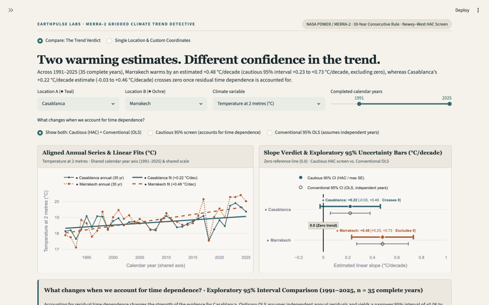
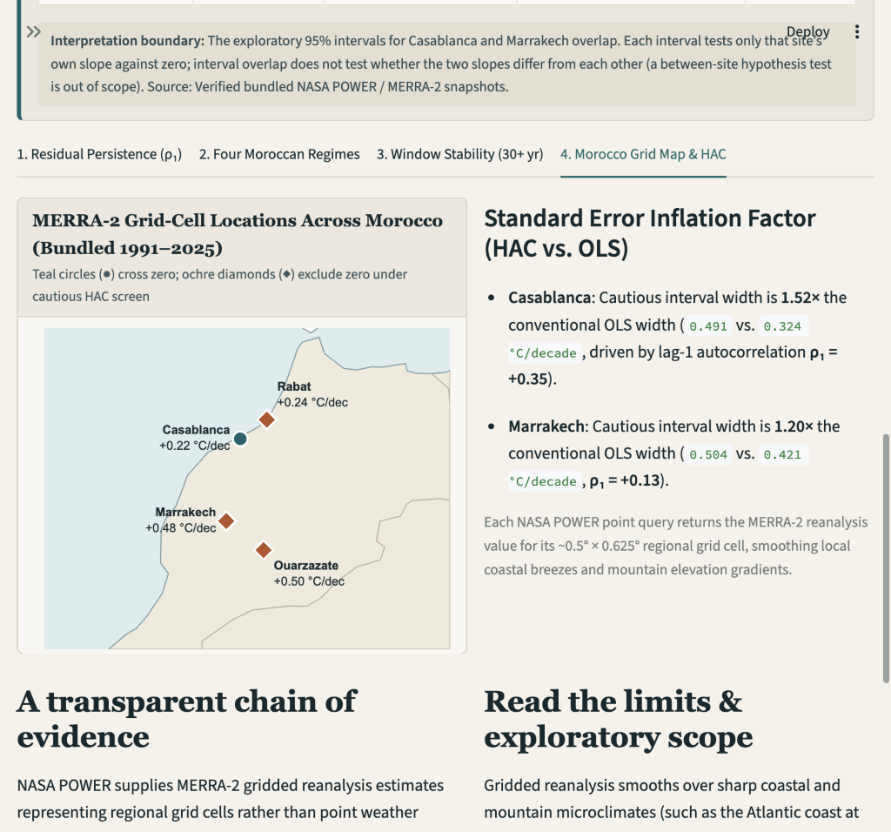

# EarthPulse — The Climate Trend Detective (V2)

**Hafida Belayd · EarthPulse Labs, Casablanca**  
An independent 2026 NASA Space Apps project for *“Be An Earth System Trend Detective!”*

[Open the live EarthPulse dashboard](https://earthpulse-labs-hafidaso.streamlit.app/) · [Seven-slide demo (`EarthPulse-Demo.pdf`)](EarthPulse-Demo.pdf)



*Interactive Spatial Grid Map & HAC Standard Error Inflation Diagnostics:*



---

## Why EarthPulse Exists

A fitted trend line on a climate chart always has a slope—even when year-to-year variability or multi-year persistence makes that slope statistically indistinguishable from zero. **EarthPulse** turns raw monthly NASA POWER / MERRA-2 reanalysis series into a transparent chain of statistical evidence so investigators can answer three questions at once:

1. **What is the estimated rate of change per decade?**
2. **Does the exploratory 95% confidence interval exclude zero?**
3. **What changes when we account for year-to-year residual dependence (autocorrelation) rather than treating consecutive calendar years as independent?**

---

## Quick Start (Python 3.11)

```sh
python -m pip install -r requirements.txt
python -m pytest -q
python -m streamlit run app.py
```

The four bundled NASA POWER responses (`Casablanca`, `Rabat`, `Marrakech`, `Ouarzazate`) cover **1991–2025** (`35` complete calendar years) and run 100% offline for instant demo reliability. Custom global coordinates (`Latitude`, `Longitude`) and earlier calendar years (`1981–1990`) query the **NASA POWER Monthly API** live with 24-hour caching.

---

## What’s New in V2: *The Trend Verdict*

### 1. Side-by-Side Evidence Comparison (First Screen)
The opening view compares **Casablanca** (`33.57°N, -7.59°E`) and **Marrakech** (`31.63°N, -7.98°E`) for near-surface temperature (`T2M`, `1991–2025`):
- **Headline Verdict**: *“Two warming estimates. Different confidence in the trend.”*
- **Aligned Annual Series & Linear Fits**: Shared calendar-year axis and shared temperature scale (`°C`), encoded by color, marker geometry (`●` circle vs. `◆` diamond), and line style (`solid` vs. `dotted/dashed`).
- **Slope Verdict & Zero-Line Dot-and-Whisker Plot**: Plots each site’s decadal slope (`°C/decade` or `mm/year/decade`) against a bold **Zero Reference Line (`0.0`)** with both conventional OLS and Newey–West HAC screening intervals.

### 2. Interactive Time-Dependence Lens (*“What changes when we account for time dependence?”*)
- **Casablanca (`T2M`, 1991–2025)**: Ordinary OLS assumes independent annual residuals and yields a narrower 95% interval (`+0.06 to +0.38 °C/decade`, `p = 0.0096`) that excludes zero. However, Casablanca’s residuals exhibit positive lag-1 autocorrelation (`ρ₁ = +0.35`). Accounting for short-range serial dependence via Newey–West HAC standard errors (`3` annual Bartlett lags) widens the cautious screening interval to **`-0.03 to +0.46 °C/decade`** (`p = 0.0786`), **crossing zero**.
- **Marrakech (`T2M`, 1991–2025)**: Exhibits weaker residual persistence (`ρ₁ = +0.13`) and a steeper warming estimate (**`+0.48 °C/decade`**). Both its conventional OLS interval (`+0.27 to +0.69 °C/decade`) and cautious HAC interval (**`+0.23 to +0.73 °C/decade`**, `p = 0.00045`) remain well above zero.

### 3. Deep-Dive Scientific Diagnostics & Reproducible Exports
- **Residual Persistence Inspector (`eₜ₋₁` vs. `eₜ`)**: Visualizes the detrended lag-1 autocorrelation structure driving the HAC interval widening.
- **Four Moroccan Climate Regimes Panorama**: Compares Atlantic coastal (`Casablanca`, `Rabat`), continental Haouz plain (`Marrakech`), and pre-Saharan High Atlas rain-shadow (`Ouarzazate`) cells side by side.
- **Multi-Window Stability Check (`30+` Year Windows)**: Evaluates consecutive `30`-to-`35`-year spans inside `1991–2025` to guard against endpoint cherry-picking.
- **Spatial Grid-Cell Map & HAC Inflation Factor**: Maps all four MERRA-2 grid centers across Morocco and reports the exact `CI_HAC / CI_OLS` interval-width inflation factor.
- **Near-Zero Precision Safeguard**: Classification always uses full floating-point precision. When a bound lies very close to zero—such as **Rabat `T2M`** (`+0.00019 to +0.48 °C/decade`, `p = 0.0498`)—display precision automatically expands so a positive bound never renders as a contradictory `+0.00`.
- **One-Click Exports**: Download combined annual `CSV`, full raw NASA `JSON`, or a formatted Markdown **Evidence Brief** (`.md`) with exact NASA request URLs.

---

## Verified Baseline Results (`1991–2025`, `n = 35` Complete Years)

| Location (MERRA-2 Grid) | Variable | Mean | Slope / Decade | Conventional 95% CI (OLS) | Cautious 95% CI (HAC / max SE) | Lag-1 `ρ₁` | Cautious Verdict |
| :--- | :--- | :---: | :---: | :---: | :---: | :---: | :--- |
| **Casablanca** (`33.57°N, -7.59°E`) | `T2M` (°C) | `18.70` | `+0.21918` | `[+0.05713, +0.38123]` | **`[-0.02648, +0.46484]`** | `+0.349` | Crosses zero (inconclusive) |
| **Rabat** (`34.02°N, -6.84°E`) | `T2M` (°C) | `18.91` | `+0.24016` | `[+0.08196, +0.39837]` | **`[+0.00019, +0.48014]`** | `+0.370` | Excludes zero (borderline) |
| **Marrakech** (`31.63°N, -7.98°E`) | `T2M` (°C) | `18.85` | `+0.48224` | `[+0.27184, +0.69265]` | **`[+0.23036, +0.73413]`** | `+0.129` | Excludes zero (warming) |
| **Ouarzazate** (`30.93°N, -6.94°E`) | `T2M` (°C) | `16.44` | `+0.49548` | `[+0.30071, +0.69024]` | **`[+0.25972, +0.73123]`** | `+0.218` | Excludes zero (warming) |
| **Casablanca** (`33.57°N, -7.59°E`) | `PRECTOTCORR` (mm/yr) | `447.92` | `+28.34238` | `[-33.37683, +90.06159]` | **`[-33.37683, +90.06159]`** | `+0.001` | Crosses zero (inconclusive) |
| **Rabat** (`34.02°N, -6.84°E`) | `PRECTOTCORR` (mm/yr) | `445.72` | `+25.14546` | `[-35.04023, +85.33115]` | **`[-35.04023, +85.33115]`** | `+0.015` | Crosses zero (inconclusive) |
| **Marrakech** (`31.63°N, -7.98°E`) | `PRECTOTCORR` (mm/yr) | `286.40` | `-0.40482` | `[-34.09519, +33.28555]` | **`[-34.09519, +33.28555]`** | `-0.148` | Crosses zero (inconclusive) |
| **Ouarzazate** (`30.93°N, -6.94°E`) | `PRECTOTCORR` (mm/yr) | `211.41` | `-3.26871` | `[-25.11467, +18.57725]` | **`[-25.11467, +18.57725]`** | `-0.146` | Crosses zero (inconclusive) |

---

## Statistical Method & Guardrails

1. **Strict Annual Completeness**: Each calendar year requires 12 finite monthly values (`01`–`12`), rejecting the NASA fill value (`-999.0`) and ignoring the API’s month-13 summary. Temperature is weighted by calendar days per month (accounting for leap years). Precipitation multiplies each monthly mean daily rate (`mm/day`) by calendar days in that month and sums across the year (`mm/year`).
2. **30-Consecutive-Year Rule**: Trend inference requires at least `30` consecutive, complete annual values (`np.all(np.diff(year) == 1)`). Shorter or gapped windows remain viewable as raw series but are marked ineligible for trend inference.
3. **Cautious HAC Screening**: Ordinary least squares (OLS) regresses annual values on centered calendar year (`slope * 10` per decade). Two-sided `t` intervals (`df = n - 2`) use `max(SE_OLS, SE_HAC)`, where Newey–West HAC uses Bartlett kernel weights, finite-sample correction, and `max(1, floor(4 * (n / 100)^(2/9)))` annual lags (`3` lags for `n = 35`).
4. **Interpretation Boundaries**:
   - **Gridded Reanalysis**: NASA POWER provides MERRA-2 regional grid estimates, not point weather-station observations.
   - **Interval Overlap**: Each 95% interval tests that location’s own slope against zero; overlapping intervals between two locations do not test whether their slopes differ from each other.
   - **Exploratory Scope**: No multiplicity correction is applied across repeated comparisons of cities, variables, or sub-periods. Statistical significance does not establish physical causation.

See [`data/results.json`](data/results.json) for verified baseline outputs and SHA-256 snapshot checksums, [`REFERENCES.md`](REFERENCES.md) for data and software citations, and [`AI_DISCLOSURE.md`](AI_DISCLOSURE.md) for AI use.
