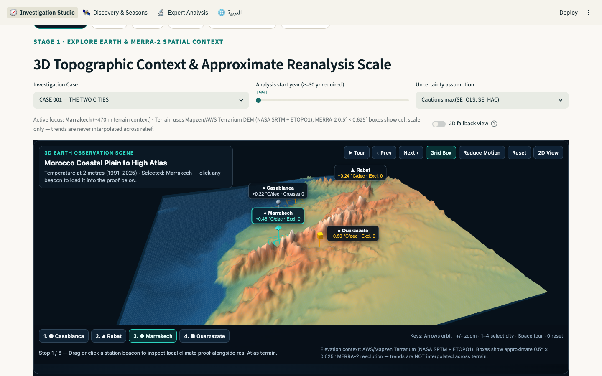
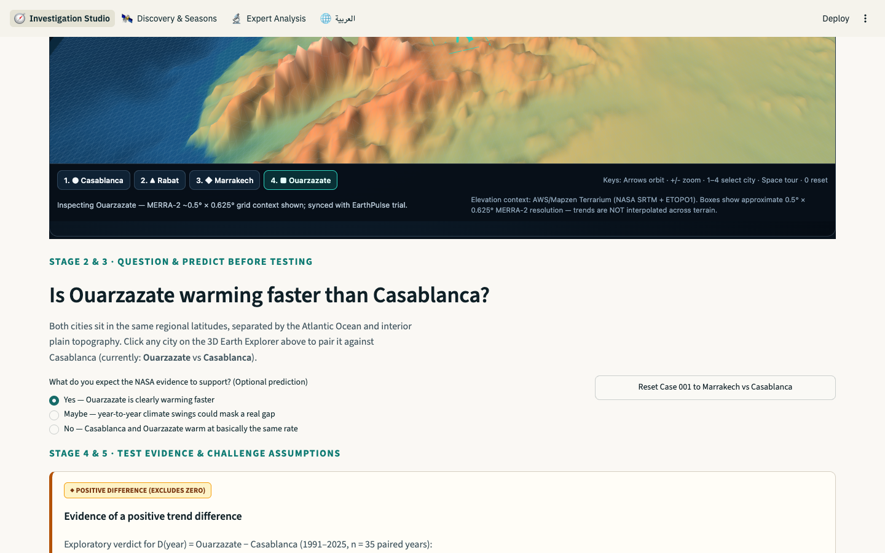
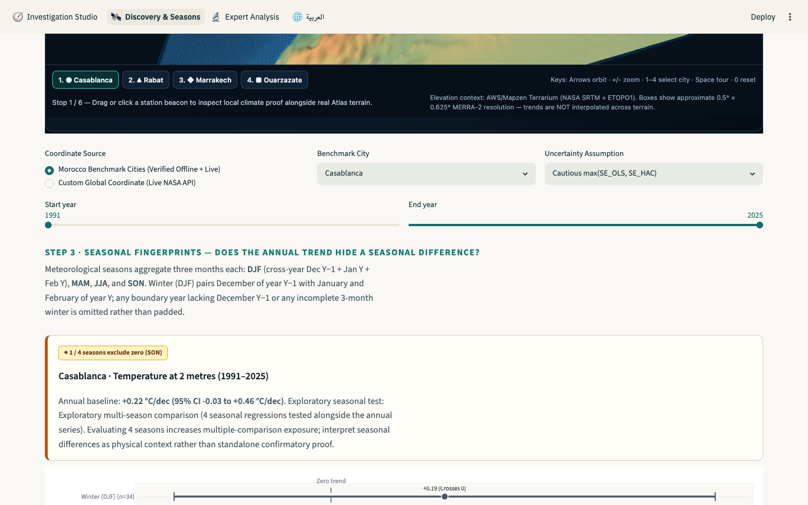
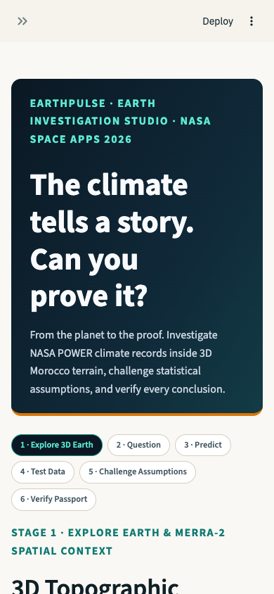

# EarthPulse — Earth Investigation Studio

**The climate tells a story. Can you prove it?**  
*From the planet to the proof. Explore NASA terrain and regional grid footprints in 3D, challenge statistical verdicts, and discover what the evidence really supports.*

- **Live Public Deployment (Streamlit Cloud)**: [https://earthpulse-labs-hafidaso.streamlit.app/](https://earthpulse-labs-hafidaso.streamlit.app/)
- **7-Slide Judge Presentation Deck (PDF)**: [`EarthPulse-Demo.pdf`](EarthPulse-Demo.pdf)
- **Official Challenge**: [NASA Space Apps 2026 — "Be An Earth System Trend Detective!"](https://www.spaceappschallenge.org/2026/challenges/earth-system-trend-detective/)
- **Languages**: **English (Default Judge Experience)** + **Optional Full Arabic RTL Interface (`العربية` — نبض الأرض)** in the top navigation bar.



---

## 1. Why EarthPulse Exists

Every ordinary least-squares (OLS) regression line drawn through a climate record produces a numerical slope. However, **two common statistical errors** frequently distort climate trend claims:

1. **Ignoring temporal autocorrelation (`lag-1 r`)**: Treating consecutive years as statistically independent when warm or wet anomalies persist across years narrows confidence intervals artificially and can create false certainty.
2. **Misreading separate confidence intervals**: Inferring that two cities warm at the same rate merely because their individual 95% confidence intervals overlap—or claiming "no climate change" when an interval crosses zero (**an inconclusive interval crossing zero is not proof of zero change or equal trends**).

**EarthPulse** pairs an interactive **3D WebGL Earth Observation scene** with a deterministic statistical proof engine backed by unaltered **NASA POWER / MERRA-2** records (`1991–2025`, `n = 35` complete years) across **Casablanca**, **Rabat**, **Marrakech**, and **Ouarzazate** — plus live NASA queries for custom global coordinates.

---

## 2. Four Views in One Unified Studio

Use the top navigation bar to switch seamlessly between:

1. **🧭 Investigation Studio (`lab.py`, Default Landing Experience)**:
   - Follows a **Six-Stage Guided Investigation Flow**: `1. Explore 3D Earth` → `2. Question` → `3. Predict` → `4. Test Data` → `5. Challenge Assumptions` → `6. Verify Passport`.
   - **Flagship 3D Earth Evidence Explorer (`earth_3d.py` + `components/earth_explorer/`)**:
     - Interactive Three.js terrain scene decoded directly from **AWS/Mapzen Terrarium elevation tiles (NASA SRTM + ETOPO1 bathymetry)**.
     - Displays Casablanca, Rabat, Marrakech, Ouarzazate, coastlines, Atlas mountain relief, and explicitly labeled approximate `0.5° × 0.625°` MERRA-2 scale boxes (never interpolating climate trends across terrain).
     - Clicking any city beacon in 3D syncs bidirectionally with the statistical proof panels below; includes a 6-stop guided camera tour with explicit Pause/Resume, Reduce Motion, keyboard navigation (`Arrows`, `+/-`, `1–4`, `Space`, `0`), and a lightweight 2D Plotly fallback.
   - **Three Core Investigation Cases** (`CASE 001 — THE TWO CITIES`, `CASE 002 — THE FALSE CERTAINTY`, `CASE 003 — THE RAINFALL QUESTION`) paired with a **4-Level Scientific Communication Summary** (`Plain Answer`, `Key Numbers`, `Statistical Method`, `NASA Source & Integrity`) and one-click **Evidence Passport (1-Page PDF)**.

| Paired Trial Proof | Guided Discovery & Seasonal Fingerprints | Mobile Responsive View (`390px`) |
| :---: | :---: | :---: |
|  |  |  |

2. **🛰️ Discovery & Seasons (`discover.py`)**:
   - **Guided Climate Discovery**: Explore **6 validated NASA POWER variables**: `T2M` (2 m Mean Temp), `T2M_MAX` (Daily Max Temp), `T2M_MIN` (Daily Min Temp), `PRECTOTCORR` (Precipitation), `RH2M` (Relative Humidity), and `WS2M` (Wind Speed at 2 m), either offline via unaltered bundled snapshots (`data/discovery/*.json`) or live globally via `(lat, lon)`.
   - **Seasonal Fingerprints**: Asks *"Does the annual trend hide a seasonal difference?"* across **DJF**, **MAM**, **JJA**, and **SON**. Cross-year `DJF` strictly pairs `Dec(Y−1) + Jan(Y) + Feb(Y)` without boundary padding (`1991` omits cleanly when history begins Jan 1991, giving `n = 34` complete winters) and surfaces an explicit 4-season multiplicity caveat. Notice how Casablanca's annual `T2M` crosses zero while **Autumn (`SON`) warms at `+0.37 °C/decade` excluding zero**!

3. **🔬 Expert Analysis (`expert_en.py`)**:
   - Full workbench featuring *The Climate Trial*, *Compare: The Trend Verdict*, *Single Location & Custom Coordinates*, rolling 30–35 year sensitivity screens, *The Uncertainty Lens* (`SE_OLS`, raw `SE_HAC`, `SE_HAC / SE_OLS` ratio explicitly distinguished from Type-I error rate), *The Grid-Cell Reality Map*, and downloadable CSV/Markdown/JSON/PDF artifacts.

4. **🌐 العربية (`expert_ar.py` — `/arabic`)**:
   - Optional complete technical Arabic RTL interface (**نبض الأرض — محاكمة المناخ**) preserved cleanly for Arabic-speaking researchers and educators.

---

## 3. Verified Scientific Baseline (`1991–2025`, `n = 35` Complete Years)

| Location / Comparison | Variable | Fitted Slope / Decade | Conventional 95% CI (OLS) | Cautious 95% CI (`max(OLS, HAC)`) | Verdict / Key Insight |
| :--- | :--- | :---: | :---: | :---: | :--- |
| **Casablanca** | `T2M` (°C) | `+0.21918` | `[+0.057, +0.381]` | `[-0.026, +0.465]` | Annual crosses 0 (`lag-1 r = +0.35`); **`SON` = `+0.37` (excl. 0)** |
| **Marrakech** | `T2M` (°C) | `+0.48224` | `[+0.272, +0.693]` | `[+0.230, +0.734]` | **Excludes 0 (Warming)** (`lag-1 r = +0.13`) |
| **Marrakech − Casablanca** (`D`) | `T2M` (°C) | **`+0.26306`** | `[+0.144, +0.382]` | **`[+0.144, +0.382]`** | **Positive Trend Difference** (`p = 8.12e-05`, `r = +0.83`) |
| **Rabat − Casablanca** (`D`) | `T2M` (°C) | `+0.02098` | `[-0.009, +0.051]` | `[-0.011, +0.053]` | **Inconclusive (`≠ Equal`)** (`p = 0.1976`) |
| **Marrakech** | `PRECTOTCORR` | `-0.405` | `[-34.10, +33.29]` | `[-34.10, +33.29]` | **Inconclusive (`≠ No change`)** |
| **Marrakech** | `RH2M` (%) | `-1.210` | `—` | `[-2.311, -0.109]` | **Excludes 0 (Drying trend)** vs. coastal Casablanca (`+0.26`) |

---

## 4. Official NASA & Open Terrain Resources, References & AI Usage Disclosure

- **[NASA POWER Monthly and Annual API (`v2.10.0`)](https://power.larc.nasa.gov/docs/services/api/temporal/monthly/)**: Unaltered source for `T2M`, `PRECTOTCORR`, `T2M_MAX`, `T2M_MIN`, `RH2M`, and `WS2M` (`data/*.json` and `data/discovery/*_extended.json`).
- **[NASA GMAO MERRA-2 Reanalysis](https://gmao.gsfc.nasa.gov/reanalysis/MERRA-2/)**: Underlying `0.5° latitude × 0.625° longitude` gridded reanalysis.
- **[NASA Giovanni](https://giovanni.gsfc.nasa.gov/giovanni/)**: Official challenge visualization and Earth system variable cross-reference.
- **[AWS Open Data Terrain Tiles / Mapzen Terrarium](https://registry.opendata.aws/terrain-tiles/)**: Elevation tiles combining NASA SRTM/NASADEM land topography and ETOPO1 ocean bathymetry (`data/morocco_dem_terrarium.json`) used strictly for non-interpolated 3D geographic context.
- **Methodology**: Newey, W. K., & West, K. D. (1987), *Econometrica*, 55(3), 703–708; WMO 30-consecutive-complete-years rule. See [`REFERENCES.md`](REFERENCES.md).

### AI Usage Disclosure
In accordance with NASA Space Apps Challenge transparency rules (see [`AI_DISCLOSURE.md`](AI_DISCLOSURE.md)):
- Generative AI coding tools assisted with Three.js 3D viewport scaffolding, Streamlit UI architecture, bilingual English/Arabic localization, ReportLab vector PDF chart formatting, and automated test authoring.
- **Zero climate measurements, terrain elevations, coordinates, or statistical outputs were generated or modified by AI.** All datasets come unaltered from NASA POWER and AWS/Mapzen Terrarium tiles, and all statistical numbers are computed deterministically by [`analysis.py`](analysis.py) and verified by **24 automated `pytest` tests** plus headless Playwright E2E checks.

---

## 5. Scientific Limitations & Interpretation Guardrails

- **Terrain & Grid Scale vs. Point Weather Stations**: NASA POWER represents `0.5° × 0.625°` (`~55 km × 59 km`) regional grid estimates. The 3D DEM terrain provides geographic context only — EarthPulse applies no topographic downscaling and never interpolates climate trends across terrain.
- **Inconclusive ≠ Zero Change / Equal Trends**: Intervals crossing zero mean the trend is indistinguishable from natural interannual variability in that window, never proof of stasis.
- **Standard Error Ratio (`SE_HAC / SE_OLS`)**: Measures relative change in estimated standard error only — **never** a Type-I error rate or false-positive probability.
- **Exploratory Scope & Multiplicity**: Multi-city comparisons, 4-season fingerprints, and shifting start years are exploratory `t` intervals (`df = n − 2`) without family-wise adjustment.

---

## 6. Local Installation, Testing & Execution

```bash
python3 -m pip install -r requirements.txt
python3 -m pytest -v
python3 -m streamlit run app.py
```

### Repository Structure
- [`app.py`](app.py) — Top-navigation router (`Investigation Studio` [default English], `Discovery & Seasons`, `Expert Analysis`, `العربية`)
- [`lab.py`](lab.py) — Flagship **Earth Investigation Studio** (Six-Stage flow + 3D Earth Explorer + CASE 001/002/003 + Evidence Passport)
- [`discover.py`](discover.py) — **Guided Discovery (6 NASA parameters)** & **Seasonal Fingerprints (`DJF`, `MAM`, `JJA`, `SON`)**
- [`earth_3d.py`](earth_3d.py) & `components/earth_explorer/` — Three.js DEM WebGL 3D Explorer + 2D Plotly fallback
- [`studio_ui.py`](studio_ui.py) — Shared editorial design system, journey ribbon, 4-level scientific cards & Plotly charts
- [`expert_en.py`](expert_en.py) & [`expert_ar.py`](expert_ar.py) — Full English & Arabic RTL Expert Analysis workbenches
- [`analysis.py`](analysis.py) — Deterministic annual/seasonal aggregation, OLS, Newey–West HAC, Paired Trial, and SHA-256 verification
- [`brief_pdf.py`](brief_pdf.py) — One-page A4 Evidence Passport PDF generator with embedded vector plots & SHA-256 checksums
- [`test_analysis.py`](test_analysis.py) — **24 automated `pytest` verification tests**
- [`EarthPulse-Demo.pdf`](EarthPulse-Demo.pdf) — Strict **7-slide** judge presentation deck
